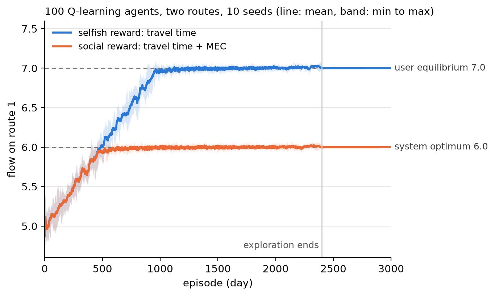
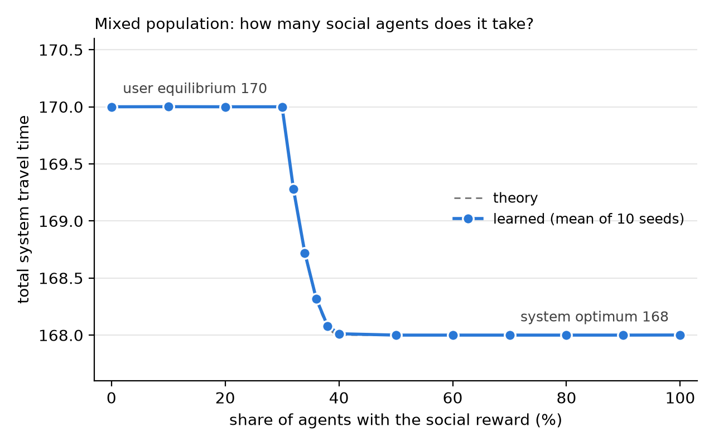

# q-routing

Independent Q-learning agents choosing between two routes. With a selfish reward (own travel time) they learn the user equilibrium; with a social reward (own travel time plus the marginal external cost) they learn the system optimum. A mixed-population experiment shows how many social agents it takes before the system improves. Pure Python; matplotlib only for the figures.

## Why this project

My research is on marginal external costs (MEC) for autonomous-vehicle routing. The idea behind using MEC in a reward is simple: an agent that also pays for the delay it causes to others should stop crowding the fast route. I wanted to check that idea in the smallest setting where the right answer can be worked out by hand, before moving to a traffic simulator.

## Setup

- Two routes with travel times `t1 = 10 + x1` and `t2 = 14 + x2`, total demand 10.
- 100 agents, each carrying 0.1 of the demand. Every episode each agent picks a route.
- Stateless tabular Q-learning, learning rate 0.1, epsilon decaying linearly from 1 to 0 over the first 2,400 of 3,000 episodes.
- Selfish reward: `-t`. Social reward: `-(t + x * dt/dx)`.
- 10 seeds per configuration; reported values are averages over the last 200 episodes.

Solved by hand, the user equilibrium is a 7 / 3 split with total travel time 170, and the system optimum is a 6 / 4 split with total travel time 168.

## Result 1: the reward decides the equilibrium

| Reward | Flow on route 1 | Flow on route 2 | Total travel time |
|---|---|---|---|
| Selfish | 7.00 | 3.00 | 170.00 |
| Social | 6.00 | 4.00 | 168.00 |

All 20 runs converge to the theoretical values.



Both populations start from a random 5 / 5 split. The social agents stop at 6, the selfish agents continue to 7. The only difference between the two runs is the MEC term in the reward.

## Result 2: a minority of social agents changes nothing



| Share of social agents | Total travel time | Mean time, social agents | Mean time, selfish agents |
|---|---|---|---|
| 0% | 170.00 | - | 17.00 |
| 30% | 170.00 | 17.00 | 17.00 |
| 40% | 168.01 | 17.91 | 16.06 |
| 50% | 168.00 | 17.60 | 16.00 |
| 100% | 168.00 | 16.80 | - |

Up to a 30% share the total travel time does not move. Social agents shift to route 2, route 1 becomes faster, and selfish agents from route 2 move over and fill the gap. The system improves only once the social agents outnumber the flow that route 2 carries at the user equilibrium, and the full gain is reached at 40%.

The social agents pay for the gain. At a 50% share they travel 17.60 on average while the selfish agents travel 16.00. When every agent is social the average is 16.80, lower than the 17.00 of the fully selfish population, but each agent would still gain by switching back to the selfish reward.

## Limits

This is a two-route example with linear travel times, no traffic simulator and no state in the Q-table. The 30% and 40% thresholds belong to this example. The MEC is computed exactly from the travel-time function; on a real network it has to be estimated.

## Run

```
python train.py
```

```
python plot.py
```

```
python mixed.py
```